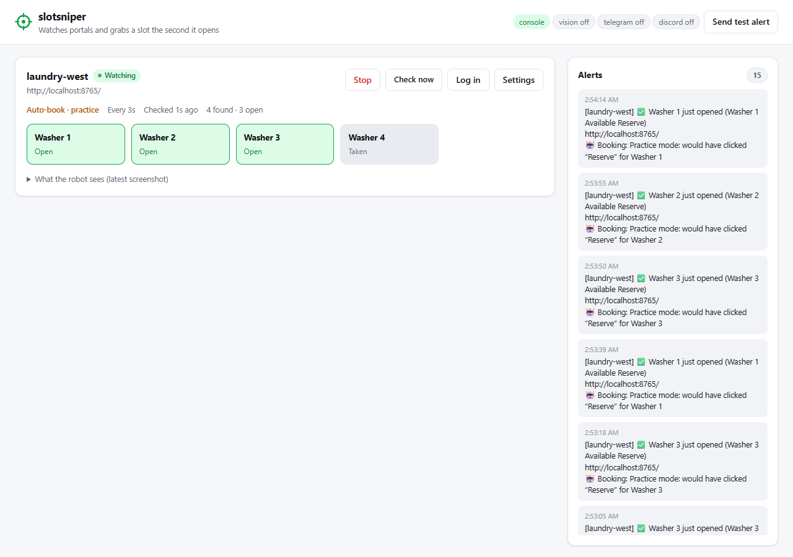

# slotsniper

**Stop refreshing the laundry / gym / class registration page.** slotsniper watches it for you
and the second a slot opens it texts you on Telegram or Discord, and can even book it for you.



---

## Getting started (no coding needed)

You'll do this once. It takes about 5 minutes.

### 1. Install Python
Python is the free program that runs slotsniper.

- Go to **https://www.python.org/downloads/** and click the big yellow **Download Python** button.
- Open the file you downloaded.
- **Windows:** on the first screen, **tick "Add python.exe to PATH"** at the bottom, then click *Install Now*.
  (If you miss this box, slotsniper won't find Python. Just run the installer again and tick it.)
- **Mac:** click through the installer normally.

### 2. Download slotsniper
- At the top of this page, click the green **`<> Code`** button, then **Download ZIP**.
- Find the ZIP in your Downloads folder and unzip it:
  - **Windows:** right-click it, choose **Extract All…**, then click **Extract**.
  - **Mac:** double-click it.
- You'll get a folder called `slotsniper-main`. Move it somewhere easy to find, like your Desktop.

### 3. Start it
Open the `slotsniper-main` folder and double-click:

| Windows | Mac |
|---|---|
| **`start.bat`** | **`start.command`** |
| If a blue "Windows protected your PC" box appears, click **More info → Run anyway**. | If it says it "can't be opened", **right-click → Open → Open**. |

The first time, a black window appears and installs what it needs, which takes 1–3 minutes.
Then **your web browser opens the slotsniper dashboard** by itself.
Keep the black window open while you use slotsniper. Closing it stops slotsniper.

> Dashboard didn't open? Type **http://127.0.0.1:8000** into your browser.

### 4. Try the demo
slotsniper comes with a pretend laundry website so you can see it work right away.
- On the dashboard, click **Start watching**.
- Within a few seconds the machines appear: 🟢 **Open** or ⬜ **Taken**.
- When a machine opens, an alert appears on the right. In *practice mode* it shows what it *would* have clicked.
- Open **http://localhost:8765** in another tab to see the pretend laundry site itself.

---

## Using it on your real school site

1. On the dashboard, click **Settings**.
2. Paste the address of the page that lists the slots (e.g. your laundry or gym booking page) into **Page to watch**.
3. Set **Check every** to **30 seconds or more**. Checking faster can get you blocked and isn't fair to the school's servers.
4. Optional: fill in **Only these slots** with words to match, such as `washer` or `mon|wed`.
5. Choose **Just alert me** or **Book it for me**. Leave **Practice mode** ticked until you've seen it pick the right slot.
6. Click **Save**.
7. If the site needs you to sign in, click **Log in**. A browser window opens. Sign in like normal
   (school login, Duo, etc.), then click **I'm logged in** on the dashboard.
   slotsniper remembers the login. It never sees or saves your password.
8. Click **Start watching**.

**Is it working?** If the machines or time slots show up on the dashboard, you're good.
If nothing shows up, open **What the robot sees** to look at the screenshot.
Some sites need small tweaks to `config.yaml` (see [For developers](#for-developers)), or the
optional AI vision feature below.

## Getting alerts on your phone

In the slotsniper folder there's a file called **`.env`**. It's created the first time you run it,
and on a Mac it may be hidden: press `Cmd + Shift + .` to show it.
Open it with Notepad (Windows) or TextEdit (Mac) and fill in one of these:

**Telegram (recommended)**
1. In Telegram, message **@BotFather**, send `/newbot`, and follow the steps. It gives you a *token*,
   which looks like `123456:ABC-xyz`. Paste it after `TELEGRAM_BOT_TOKEN=`.
2. Send any message to your new bot.
3. Open `https://api.telegram.org/bot<YOUR_TOKEN>/getUpdates` in your browser. Find `"chat":{"id":` and copy
   the number after it. Paste it after `TELEGRAM_CHAT_ID=`.

**Discord**
- In your server: *channel settings → Integrations → Webhooks → New Webhook → Copy Webhook URL*.
  Paste it after `DISCORD_WEBHOOK_URL=`.

Save the file, close the black window, and double-click `start` again.
Then click **Send test alert** on the dashboard. Your phone should buzz. 📱

> Never share or upload your `.env` file. It holds your private keys. (It's already excluded from git.)

## Optional: AI vision
Some sites are built in ways slotsniper can't read directly. If you add an Anthropic API key
(`ANTHROPIC_API_KEY=` in `.env`), slotsniper takes a screenshot and has Claude read the page and
find the book button instead. The dashboard shows **vision on** when it's active.

## Please use it responsibly
- Keep checks **30+ seconds apart** on real sites.
- slotsniper does **not** get around CAPTCHAs or bot blockers. If a site shows one, slow down.
- Check your school's rules. Automatic *booking* may not be allowed everywhere (especially class
  registration), even where alerts are fine. **Just alert me** is always the safe choice.

---

## For developers

### Architecture
```
dashboard (aiohttp, 127.0.0.1) ──► TargetWatcher per target (asyncio task, persistent browser profile)
                                      │
page load ─► session check ─► extract slots ─► diff vs last poll ─► notify / book ─► jittered sleep
                 │                 │
                 │                 ├─ DOM: role/text locator chains (survive class-name churn)
                 │                 └─ VLM: screenshot → Claude → slots + click coordinates
                 └─ expired? alert once, show "Log in"
```

| Problem | How it's handled |
|---|---|
| SPA renders late | `first_matching` polls locator chains until something appears |
| Minified/random CSS classes | Locator specs prefer ARIA roles and visible text (`role:button:(?i)reserve`) over CSS; each field is a fallback chain |
| Portal redesign breaks selectors | If every DOM spec matches nothing, it warns once and falls back to a vision model reading the screenshot |
| List re-renders between read and click | Booking re-finds the slot by label, not index, then checks the button is enabled |
| SSO / Duo / 2FA | A human logs in once in a real window, and the persistent profile keeps the cookies. No passwords stored |
| Session expiry | URL/text heuristics, one alert, and a dashboard "Log in" prompt |
| Flaky network / 500s | Exponential backoff (up to 16×), with an alert after 3 failures in a row |
| Alert spam | Alerts fire on *transitions* (closed→open), with one-shot warnings |
| Accidental bookings | `dry_run` practice mode, a `max_bookings` cap, and a dashboard that binds to localhost with same-origin POSTs only |

### Command line
```bash
pip install -r requirements.txt
cp config.example.yaml config.yaml
python mock_portal/server.py          # optional demo portal (add --require-login to test sessions)
python -m slotsniper dashboard        # web UI at http://127.0.0.1:8000
python -m slotsniper watch            # headless, no UI
python -m slotsniper probe            # read-only: print what it sees once
python -m slotsniper login -t NAME    # log in to a target in a visible window
python -m slotsniper test-notify
```
`config.yaml` sets `browser.channel` to `msedge` or `chrome` to use an installed browser. If that browser
isn't there, slotsniper falls back to Playwright's Chromium (`python -m playwright install chromium`).

### Locator specs
`css:SEL` · `text:REGEX` · `role:ROLE[:NAME_REGEX]` · `label:REGEX` · `testid:ID` ·
fields also accept `attr:NAME` and `text`. A leading `(?i)` makes a regex case-insensitive.
See the commented `gym-slots` example in `config.example.yaml`.

### Vision fallback
Uses `claude-opus-5-5` at `effort: low` with structured JSON output and the server-side refusal fallback
(`fallbacks: "default"`). Set `extractor.kind: vlm` to always use vision, e.g. for canvas UIs.

### Layout
```
start.bat / start.command   one-click launchers (venv + deps + dashboard)
slotsniper/
  dashboard.py  local web UI + JSON API
  web/          dashboard page (vanilla HTML/JS, no build step)
  watcher.py    poll loop, session checks, backoff
  extract.py    DOM extractor + Claude vision extractor → Slot
  book.py       click + confirmation check
  locators.py   spec strings → Playwright locators, fallback chains
  notify.py     console / Telegram / Discord
  state.py      per-target open/booked memory (JSON)
  config.py     pydantic schema for config.yaml
mock_portal/server.py   a deliberately annoying fake portal for offline testing
```

MIT licensed.
